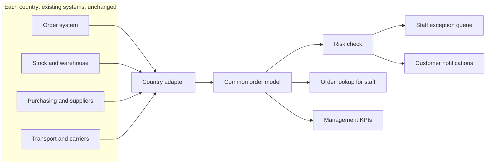

# Solution Brief: Round 1

Working draft. Every choice below is reasoned from the case brief (`round-1.md`). Anything the brief does not confirm is either stated under Assumptions or listed under Open questions.

## Index

- [Chosen opportunity](#chosen-opportunity)
- [Why this comes first](#why-this-comes-first)
- [Who experiences it](#who-experiences-it)
- [Assumptions](#assumptions)
- [Proposed solution](#proposed-solution)
- [Inputs: data sources](#inputs-data-sources)
- [Processing flow](#processing-flow)
- [Outputs](#outputs)
- [Data freshness](#data-freshness)
- [Why this architecture](#why-this-architecture)
- [Where AI creates value](#where-ai-creates-value)
- [MVP scope](#mvp-scope)
- [Rollout across markets](#rollout-across-markets)
- [How impact is measured](#how-impact-is-measured)
- [Illustrative business case](#illustrative-business-case)
- [Anticipated challenges and responses](#anticipated-challenges-and-responses)
- [Open questions](#open-questions)

---

## Chosen opportunity

**Reliable order and delivery fulfilment across markets.**

The brief says that problems with orders and deliveries "can affect efficiency and reliability". Reliability is what lets Company A "compete and serve its customers effectively" in a highly competitive market.

---

## Why this comes first

| Challenge | Assessment against the brief |
|---|---|
| Fragmented systems | Replacing systems in three countries conflicts with "time to market is critical". It is better addressed gradually, as a side effect of a solution that works across the existing systems. |
| Manual processes | High impact (the brief's example is Denmark), but the brief does not say which processes are manual. That makes it hard to scope an MVP without inventing the problem. |
| Inconsistent operations | Real, but it describes a symptom of different ways of working. It is hard to show measurable impact quickly. |
| **Delivery & fulfilment** | **Concrete domain (orders and deliveries), directly customer-facing, linked to "store and distribution operations", which the brief explicitly asks us to consider. The brief's example is Sweden.** |

**Argument:** fulfilment is the challenge where one solution can show measurable value fast, without first replacing systems. It also creates a shared layer that starts reducing fragmentation.

---

## Who experiences it

Based on the customer groups and stakeholders named in the brief:
- **Construction businesses** and **individual consumers** receiving orders
- **Store and distribution employees** handling orders and deliveries
- **Management**, who need to scale improvements across markets

---

## Assumptions

The brief does not describe the fulfilment problem in detail. The assumptions below fill that gap. Each is stated explicitly, justified, and must be presented as an assumption in the proposal.

**Customers and orders**

| Assumption | Justification |
|---|---|
| Construction businesses are the largest revenue group and the most sensitive to delivery reliability. | They are named first in the brief. Construction work runs on schedules, so a late or incomplete delivery stops work on site and costs the customer money. |
| A large share of orders is delivered to job sites or homes rather than collected in store. | Building materials are heavy and bulky, so customers often cannot carry them. |
| One order is often fulfilled from several sources (store stock, a central warehouse, direct from a supplier), so it arrives in several parts. | The brief asks us to consider "store and distribution operations" as separate elements, which implies more than one fulfilment source. |
| Deliveries are planned for a day or a time window, usually at least one day ahead. | Bulky deliveries need truck capacity and route planning, which is done in advance. |

**Current way of working**

| Assumption | Justification |
|---|---|
| Order, stock, purchasing and transport data are held in different systems that do not share data. | Directly follows from "fragmented systems" and from each country building its own systems. |
| To answer "where is my order?", employees check several systems manually or call colleagues and carriers. | This is how fragmented systems turn into "manual processes" that "require significant employee effort". |
| Delays are usually discovered late: when the customer calls, or when a delivery fails. | Without a shared view of the order, nobody sees a problem building up across systems. |
| Most delays start before the truck leaves: missing stock, a late supplier, or picking not done in time. | A delivery can only leave on time if every part of the order is ready. These upstream steps are where fragmented data hides problems. |
| Customers receive little or no proactive information about their delivery. | Same root cause: no single source of order status to inform them from. |

**Market differences**

| Assumption | Justification |
|---|---|
| Sweden has the most deliveries over long distances and the heaviest use of external carriers, which makes fulfilment its biggest pain. | Consistent with the brief's example that fulfilment "may have greater business impact" in Sweden. |
| Denmark has the same visibility gap, but its pain shows up mainly as manual effort for employees. | Consistent with the brief's example for Denmark (manual processes). |
| In Norway, each store handles delayed and failed orders in its own way. | Consistent with the brief's example for Norway (store operations) and with "inconsistent operations". |

**Technology and delivery**

| Assumption | Justification |
|---|---|
| Every country's systems can at least export order and delivery data, through APIs, database access or scheduled file exports. | Retail order and finance systems almost always support data export. If only file exports are available, the adapter reads data in batches. |
| Transport systems and carriers report milestone events (dispatched, delivered, failed), but there is no live GPS position of drivers. | Milestone status is standard for carriers and delivery planning tools. Live tracking is not needed for this solution. |
| At least 12 months of historical order and delivery data exists. | Retailers keep transaction history for accounting. This is enough to train a first delay-risk model. |
| A small cross-functional team can deliver the MVP in about 12 weeks. | The MVP only reads data, covers one market and a limited set of stores, and replaces no existing system. |

---

## Proposed solution

**A fulfilment control layer that sits on top of each country's existing systems.**

It does three things that no single existing system can do today:
- **Join** the data about one order from every system it touches into one order timeline.
- **Check** that timeline against the delivery promised to the customer, and flag orders at risk.
- **Act** by giving employees a task with a suggested fix and by informing the customer early.

- **One strategic solution:** the common order model, risk check, staff view and notifications are the same in every market.
- **Not one identical implementation:** each country has its own adapter, and local rules (cut-off times, delivery windows, language, channels) are configuration, not new code.

---

## Inputs: data sources

What each country's systems send into the layer. The layer only **reads** from these systems in the MVP.

| Source system | Data | Why it is needed |
|---|---|---|
| Order system (ERP or webshop) | Order number, customer, customer type (business or consumer), ordering store, delivery address, promised delivery date or window, order lines (product, quantity) | Defines what was promised to whom |
| Stock and warehouse | Stock per product and location, reservation, picking and packing status with timestamps | Shows whether each order line can be ready in time |
| Purchasing and suppliers | Purchase orders for out-of-stock or direct-from-supplier items, supplier-confirmed delivery date, shipping notice | Shows whether supplier items will arrive in time |
| Transport and carriers | Shipment number, planned delivery date and window, milestone events (dispatched, delivered, failed, reason) | Shows the last step and its outcome |
| Customer records | Contact details, preferred channel and language | Needed to inform the customer |

Note: no live driver position is required. The risk check relies on upstream readiness and milestone events, which is where most delays are assumed to start.

---

## Processing flow

**Extract (adapter, per country)**
Reads changes from each source. Method depends on what the system supports: API, database change capture, or scheduled file export.

**Map (adapter, per country)**
Translates local fields and codes into the common order model: one order, several order lines, each line linked to its fulfilment source (store, warehouse, supplier) and to a shipment.

**Join (common layer)**
Builds one **order timeline** per order from all sources. Example: order 1001 has line A in store stock (picked), line B from the central warehouse (not picked), line C from a supplier (confirmed for Thursday), all promised for Wednesday.

**Risk check (common layer)**
Compares every line with the promised delivery. Example rules:
- A supplier-confirmed date is later than the promised delivery date
- Stock for a line is not reserved one day before dispatch
- Picking has not started a set number of hours before the truck's departure
- The shipment is not dispatched by the cut-off time
- The carrier reports a failed delivery

**Act (common layer)**
For each at-risk order: create an exception for the responsible store, with the reason and a suggested action, and send the customer an update when the promised delivery will change.

**What the layer writes:** only its own data (exceptions, who handles them, their status, notifications sent). It does not write into the countries' systems in the MVP. Employees take the actual action, for example moving stock or rebooking a delivery, in the existing systems as today.

---

## Outputs

| Output | Who uses it | Content |
|---|---|---|
| Exception queue | Store and distribution employees | At-risk orders, the reason, suggested action, owner, status (open, in progress, resolved) |
| Order lookup | Customer-facing employees | Full timeline of one order across all systems, so a question is answered from one screen |
| Customer notifications | Business and consumer customers | Delivery confirmation, split delivery details, early delay warning with the new expected date |
| KPI view | Store, country and group management | On-time and complete delivery rate, exception reasons, comparison between stores and countries |

---

## Data freshness

Real time is not required. The required freshness follows from **how much time employees need to act** on a problem.

| Use case | Required freshness | Reason |
|---|---|---|
| Risk check on upstream steps (stock, supplier, picking) | 15 minutes | Deliveries are planned at least a day ahead, so a problem found within 15 minutes still leaves hours to fix it. |
| Delivery-day events (dispatched, failed) | 5 to 15 minutes | Lets the store inform the customer and rebook on the same day. |
| Order lookup for employees | 15 minutes | An answer up to 15 minutes old is acceptable for "where is my order?". |
| KPI view | Daily | Used for trends and comparison, not operations. |

**Engineering choice:** frequent polling or change capture every 5 to 15 minutes where the source allows it, and hourly file imports as a fallback for older systems. Real-time streaming would add cost and complexity in every country without changing what employees can do.

---

## Why this architecture

| Alternative | Why it is weaker for this case |
|---|---|
| Replace all systems with one common platform | Takes years and carries high risk. Conflicts with "time to market is critical". |
| Direct integrations between each pair of systems | The number of integrations grows quickly with every system and country. There is still no single view of an order and no common place to detect risk. |
| Data warehouse with daily reports | Shows problems after they have happened. No action for employees and no customer communication. |
| Full order management system that takes over fulfilment | Powerful, but requires writing into every country's systems and changing processes at once. Too large for a first step. |
| **Read-only control layer (proposed)** | **Fast to deliver, low risk because it changes no existing system, actionable for employees and customers, and reusable in every market through adapters. It can grow into a full order management system later.** |

The core value is the **join**. No existing system knows that order 1001 will be late because a supplier item in another system is confirmed one day after the promise. Only a layer that sees all sources can detect that.

---

## Where AI creates value

**Principle:** use rules where rules are enough, and AI only where it does something rules cannot. The MVP works without AI. Delivery estimates and the basic risk check are rule-based.

| Use | What it does | Why rules alone are not enough | Phase |
|---|---|---|---|
| Adapter mapping assistant | Suggests how fields, status codes and product data in each country's systems map to the common model | Every country's data is different. Manual mapping is the slowest part of each rollout, so this directly shortens time to market. | MVP (internal use, reviewed by engineers) |
| Multilingual customer messages and replies | Writes delay messages in Danish, Norwegian or Swedish, and answers "where is my order?" by email or chat using the order timeline | Each delay has a different combination of reasons and parts. Templates cannot cover every case clearly. | MVP: messages. Later: replies |
| Delay-risk prediction | Learns from history which suppliers, products, stores and periods are late even when the status looks fine | Rules only catch what is already visible. For example, a supplier who confirms dates but is often two days late can only be found from history. | After the pilot, once historical data is validated |
| Suggested fix | Proposes the best action, such as another store with stock or a split delivery | Weighing stock, distance and the customer's priority across many options is hard to express as fixed rules. | Later |

**Is AI required by the brief?** No. The brief asks "Where and how could AI create value in your proposed solution?" as a question to consider, not as a requirement. Showing where AI is and is not useful is a stronger answer than adding it everywhere.

---

## MVP scope

**In scope**
- One pilot market (Sweden, following the brief's example) and a limited set of stores
- One adapter reading order, stock, purchasing and transport data
- Common order model and rule-based risk check
- Exception queue and order lookup for employees
- Proactive delay notifications to customers on one channel
- AI: adapter mapping assistant and multilingual notification texts

**Out of scope for the MVP**
- Writing back into existing systems
- Replacing any existing system
- All three markets at once
- Live driver tracking and route optimisation
- AI delay-risk prediction (follows after the pilot)

---

## Rollout across markets

| Phase | Market | Focus |
|---|---|---|
| Pilot | Sweden | Prove impact on fulfilment, where the brief suggests it matters most |
| Expand | Denmark, Norway | Build country adapters, configure local rules, adapt to local processes |
| Extend | All markets | Add AI risk prediction, suggested fixes, and write-back into existing systems |

Change management: involve store and distribution employees in the pilot, and roll out store by store rather than all at once.

---

## How impact is measured

Metric types only. The brief gives no baseline figures.
- On-time and complete delivery rate
- Number of delayed or failed orders
- Share of delays detected before the delivery date
- Time employees spend on order follow-up
- Customer satisfaction with delivery

---

## Illustrative business case

All figures are assumed, for illustration only. Replace them with real data if the organisers provide it. The structure of the calculation matters more than the numbers.

| Item | Assumed value |
|---|---|
| Pilot stores in Sweden | 20 |
| Deliveries per year in the pilot | 40,000 |
| Share of deliveries that are late, incomplete or failed | 10% (4,000 deliveries) |
| Cost of one problem delivery (redelivery, handling, goodwill) | EUR 100 |
| "Where is my order?" contacts | 1 per 4 deliveries (10,000 per year), 5 minutes each |

| Effect of the MVP | Result |
|---|---|
| Problem deliveries reduced by 30% through early warning | 1,200 fewer per year, about EUR 120,000 saved |
| Status contacts reduced by 50% through proactive updates | about 400 employee hours freed per year |

Scaled across hundreds of stores in three countries, the same logic gives a much larger effect. That is the argument for one shared solution instead of local fixes.

---

## Anticipated challenges and responses

**"Denmark is the home market and its top issue is manual processes. Why not start there?"**
The brief does not say which processes are manual, so any Denmark-first solution would rest on a guess. Our solution also removes a manual process that we can name precisely: employees chasing order status across systems. Denmark benefits from the same layer in the second phase.

**"Norway's priority is store operations. What does this do for Norway?"**
The exception queue gives every store the same list of at-risk orders and the same next steps. That makes exception handling consistent across stores, which addresses "inconsistent operations" directly.

**"Why not fix the root cause, fragmented systems?"**
Replacing systems in three countries takes years, which conflicts with "time to market is critical". The shared layer creates one common order data model across countries now. That is a first, low-risk step towards consolidation.

**"Is this one solution, or three projects?"**
One solution: the same common model, risk check and user features everywhere. Only the adapters and local configuration differ, which is exactly what "one strategic solution does not necessarily mean one identical implementation" allows.

**"Is this not just a dashboard?"**
A dashboard shows data. This layer joins data that sits in different systems, detects a broken promise before it happens, assigns it to a person, and informs the customer.

**"Why not real time?"**
Deliveries are planned at least a day ahead, so 5 to 15 minutes of delay in the data does not change what employees can do. Real-time streaming would add cost in every country for no business gain.

**"Without driver tracking, how can you predict delays?"**
Most delays are assumed to start before the truck leaves: missing stock, late suppliers, picking not done. The layer watches those steps, which matter more than the last kilometre.

**"What if a country's systems have no APIs?"**
The adapter reads scheduled file exports instead. Data becomes hourly rather than near-real-time, which is still far better than no shared view.

**"Delivery estimates do not need AI. Where is the AI?"**
Agreed, and the MVP uses rules for that. AI is used where rules fall short: mapping each country's data faster, writing clear messages in three languages, and later predicting delays from patterns in historical data.

**"Will employees accept another system?"**
The layer adds no data entry. It replaces searching across several systems with one view, so it removes work rather than adding it. Employees are involved from the pilot onwards, and the rollout goes store by store.

**"One solution touches only one of the four challenges."**
It targets fulfilment, but it also affects the other three: less manual status chasing, consistent exception handling across stores, and a shared data layer across fragmented systems.

---

## Open questions

If the organisers answer any of these, replace the matching assumption with the fact:
- Which order and delivery problems actually occur, and in which market
- Which systems each country uses, and whether their data can be accessed
- Whether transport data includes milestone events or only final delivery status
- Whether Sweden is genuinely the right pilot market
- Baseline figures for delivery performance
- Budget and timeline expectations
